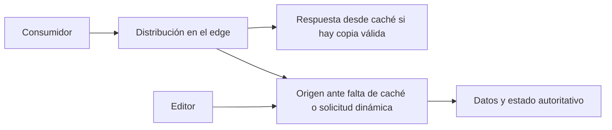
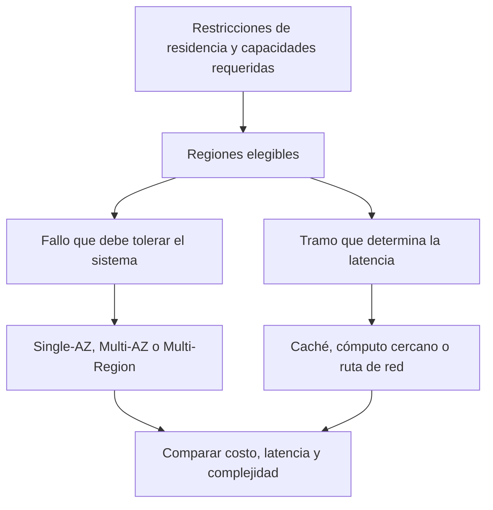

# Módulo 04 — Infraestructura global y alcance de los servicios

## Metadatos

- Estado del documento: versión final del módulo
- Estado académico: Completado
- Versión: 1.0
- Fecha de cierre y última revisión del registro: 2026-11-24
- Duración real: sin registro
- Fase: Fase 0 — Orientación y contexto
- Dominio SAA-C03: rendimiento de red y resiliencia, con contexto de seguridad y costos
- Tareas oficiales abordadas: 1.1 y 2.2 como introducción, 3.4 como refuerzo evaluado y dominio 4 como contexto transversal
- Módulos previos: 01, 02 y 03
- Caso arquitectónico principal: [Caso C — Plataforma global de contenido](../../casos/plataforma-global.md)
- Archivos relacionados: [progreso](../../docs/PROGRESO.md), [matriz de cobertura](../../docs/MATRIZ_COBERTURA.md) y [conceptos débiles](../../registros/CONCEPTOS_DEBILES.md)
- Evaluación formal: 12/12 — 100 %
- Mini retos: 11/11 — 100 %
- Aprobación explícita del participante: sí

## 1. Por qué importa

Una aplicación con usuarios en varios continentes puede necesitar distribuir archivos con baja latencia, mantener ciertos datos en una ubicación autorizada y seguir operando si falla una zona. Cada requisito condiciona una parte distinta del diseño. En el examen, una alternativa técnicamente viable puede quedar descartada si protege contra otro tipo de fallo, acelera el tramo equivocado o incumple una restricción geográfica.

## 2. Vista desde la arquitectura completa

Separar tres recorridos ayuda a decidir dónde intervenir. El consumidor pide contenido reutilizable, una solicitud dinámica puede requerir procesamiento en el backend y el editor actualiza el estado autoritativo. Una copia en caché puede atender la primera solicitud cerca del usuario. Las operaciones que dependen del origen deben llegar al backend y, según la operación, a los datos. La resiliencia de ese recorrido se analiza siguiendo todas sus dependencias.



El diagrama representa responsabilidades de una plataforma de contenido. Cada componente del origen requiere su propia decisión de ubicación y tolerancia a fallos.

## 3. Objetivos evaluables

- Distinguir AWS Region, Availability Zone, Data Center y punto de presencia.
- Clasificar servicios y recursos por alcance y explicar las consecuencias sobre ubicación de datos y tolerancia a fallos.
- Comparar Single-AZ, Multi-AZ y Multi-Region frente a fallos concretos.
- Elegir entre distribuir contenido, acercar cómputo y optimizar la ruta de red.
- Filtrar regiones por restricciones obligatorias y justificar el costo y la complejidad de la opción viable.

## 4. Requisitos previos

- Módulo 01 — Mapa de una arquitectura AWS. Recorrido de solicitudes, componentes y ubicación del estado.
- Módulo 02 — Cómo piensa un Solutions Architect. Requisito dominante, restricciones, alternativas y dominio de fallo.
- Módulo 03 — Los cuatro ejes del examen. Seguridad, resiliencia, rendimiento y costo como criterios de diseño.

## 5. Resultado demostrable

Explicar, a partir de un escenario, qué datos y servicios deben ubicarse en una región autorizada, qué dependencias deben seguir disponibles tras un fallo zonal y qué mecanismo puede reducir la latencia percibida. Justificar el descarte de una segunda región cuando la necesidad se resuelve con una alternativa de menor alcance.

## 6. Mapa del módulo

| Bloque | Tema | Pregunta de diseño |
|---|---|---|
| A | Geografía de AWS | ¿Qué parte de la carga puede fallar al mismo tiempo? |
| B | Alcance de los servicios | ¿Dónde se administra el recurso, dónde opera y cómo resiste fallos? |
| C | Infraestructura de proximidad | ¿Conviene acercar contenido, procesamiento o la entrada a la red de AWS? |
| D | Selección arquitectónica | ¿Qué restricciones filtran el diseño y qué criterio decide entre opciones viables? |

## 7. Mapa mental



El alcance administrativo, la ubicación física y la resiliencia se comprueban para cada recurso y dependencia.

## 8. Conceptos esenciales

Las descripciones de los servicios sintetizan conceptos de AWS. Los criterios de elección, descarte y examen son interpretaciones didácticas. Las conclusiones del Caso C son inferencias a partir de sus requisitos.

### Bloque A — Geografía de AWS

| Concepto | Problema y papel arquitectónico | Elección y descarte | Trade-off | Señal de examen, confusión y conexión |
|---|---|---|---|---|
| AWS Region | Ubica una carga en un área geográfica con varias Availability Zones. Es la unidad habitual de selección de servicios y ubicación de recursos regionales. | Elegir entre regiones que admitan los servicios y la ubicación de datos exigidos. Descartar una región que incumpla estas condiciones aunque esté cerca del usuario. | Proximidad, capacidades y costos pueden variar entre regiones. | Residencia de datos o pérdida regional. Elegir dos AZ dentro de la misma región sigue dejando una dependencia regional. Aplica las restricciones del Módulo 02. |
| Availability Zones y Data Centers | Una AZ comprende uno o más centros de datos separados físicamente de otras AZ, con infraestructura diseñada para limitar fallos compartidos y conectividad regional de baja latencia. El aislamiento lógico depende también de cómo se distribuyen la red, el estado y las dependencias de la aplicación. | Distribuir dependencias críticas entre AZ si deben sobrevivir a la pérdida de una de ellas. Descartar el número de instancias como prueba suficiente si todas dependen de la misma AZ. | Separar dependencias requiere capacidad, coordinación y un camino funcional de conmutación. | Fallo eléctrico o de red localizado, o pérdida de una AZ. Una AZ puede incluir varios centros de datos. Conecta con los puntos únicos de fallo del Módulo 02. |
| Single-AZ y Multi-AZ | Single-AZ concentra un componente en una zona. Multi-AZ distribuye el diseño entre zonas de una región para limitar el impacto de una caída zonal. | Considerar Single-AZ si la interrupción es aceptable. Considerar Multi-AZ si se exige continuidad zonal y se puede mantener el acceso al estado y redirigir tráfico. Descartar ambas para un requisito explícito de continuidad ante pérdida regional. | Multi-AZ puede aumentar capacidad, transferencia y esfuerzo de operación. | Continuidad ante pérdida de una AZ. Dos subnets o dos instancias por sí solas dejan el fallo abierto si comparten una dependencia crítica. Aplica resiliencia y costo del Módulo 03. |
| Multi-Region | Distribuye componentes entre regiones cuando el alcance del fallo o la proximidad exigida exceden una región. | Evaluar cuando el negocio debe operar tras perder una región o cuando la latencia exige procesamiento en otra región. Descartar activo-activo como supuesto inicial si basta resiliencia zonal o distribución en el edge. | Más capacidad, coordinación de datos, rutas y operación. La complejidad depende del patrón de recuperación. | Pérdida regional o procesamiento en geografías distintas. Usuarios globales pueden consumir contenido de un origen regional a través de una CDN. Aplica proporcionalidad del Módulo 03. |

### Bloque B — Alcance de los servicios

El alcance **global** describe una función o configuración utilizable entre regiones dentro de su ámbito de operación. El alcance **regional** vincula un recurso o servicio a una región. El alcance **zonal** restringe la ubicación de un recurso a una AZ. Para cada alternativa se analiza por separado el alcance administrativo, la ubicación física de datos y cómputo y el comportamiento ante fallos.

| Concepto | Problema y papel arquitectónico | Elección y descarte | Trade-off | Señal de examen, confusión y conexión |
|---|---|---|---|---|
| AWS Identity and Access Management (IAM), Amazon Route 53 y Amazon CloudFront | IAM gestiona identidades y permisos de alcance global en su partición. Route 53 presta funciones globales de DNS, como la resolución pública. CloudFront distribuye contenido mediante una red global de puntos de presencia. | Usar cada servicio según la necesidad de autorización, resolución de nombres o distribución. Descartar estos alcances como evidencia de que el backend o sus datos se han distribuido entre regiones. | Permisos, resolución y distribución tienen dependencias y restricciones propias. | Una política, un nombre DNS o una distribución global pueden referirse a recursos regionales. Conecta con seguridad y rendimiento del Módulo 03. |
| Amazon VPC y subnets | Una VPC define una red lógica regional. Una subnet asigna un segmento de la VPC a una sola AZ. | Usar una VPC cuando se necesite una red regional y subnets en AZ diferentes si la carga debe distribuirse. Para otra región, evaluar una VPC allí y la conectividad necesaria. | La segmentación facilita el aislamiento y exige planificar direccionamiento y rutas. | Una subnet nunca abarca dos AZ. Distribuir subnets deja pendiente cómo se distribuyen y recuperan los componentes. Conecta con límites de fallo del Módulo 02. |
| Amazon EC2 y Amazon EBS | Una instancia EC2 se ejecuta en una AZ. Un volumen EBS proporciona almacenamiento de bloques y su conexión a una instancia exige la misma AZ. | Elegir EC2 cuando la carga requiera control del entorno y EBS cuando necesite bloques para la instancia. Descartar un único volumen como estado compartido directamente entre instancias de distintas AZ. | El acceso por bloques favorece a cargas que esperan disco, con implicaciones de ubicación y recuperación del estado. | Mover cómputo a otra AZ obliga a revisar cómo estará disponible el dato. La ubicación del volumen y el alcance de una copia de recuperación son decisiones distintas. Retoma la ubicación del estado del Módulo 01. |
| Amazon S3 | Almacena objetos mediante API. Un bucket se crea en una región. El acceso desde otras regiones puede estar permitido y la redundancia depende de la clase de almacenamiento. | Elegirlo para objetos como contenido o archivos. Descartarlo como sustitución directa de un disco de bloques. Evaluar por separado cualquier requisito de copia a otra región. | El modelo de objetos cambia la interfaz de acceso. La clase, las solicitudes y la transferencia influyen en el costo. | Un nombre de bucket con alcance global en el espacio de nombres correspondiente no implica ubicación mundial ni replicación interregional. Retoma la persistencia del Módulo 01. |
| AWS Lambda, Amazon RDS y Amazon DynamoDB | Una función Lambda estándar se configura regionalmente para ejecutar código. Amazon RDS gestiona bases relacionales en una región con opciones de despliegue según motor y modalidad. Una tabla DynamoDB tiene un ámbito regional y las global tables permiten extenderla entre regiones mediante una configuración explícita. | Considerar Lambda para ejecutar código administrado, RDS si dominan los requisitos relacionales y DynamoDB si los patrones se ajustan a su modelo de claves. Descartar una solución que suponga continuidad regional automática por usar un servicio administrado. | Delegar operación reduce trabajo de infraestructura, con límites, modelos de datos y costos propios. La redundancia y el failover se evalúan según la configuración. | Distinguir entre alcance de la API, ubicación del estado y opciones explícitas de alta disponibilidad. Conecta con responsabilidades y gestión del estado del Módulo 01. |

### Bloque C — Infraestructura de proximidad

| Concepto | Problema y papel arquitectónico | Elección y descarte | Trade-off | Señal de examen, confusión y conexión |
|---|---|---|---|---|
| Edge Locations, Points of Presence y Regional Edge Caches | Los puntos de presencia (PoP) de CloudFront acercan la entrega al usuario mediante Edge Locations. Los Regional Edge Caches añaden un nivel de caché entre el borde y el origen para solicitudes elegibles. | Aprovechar esa jerarquía si se repiten solicitudes de objetos aptos para caché. Descartarla como motivo para ubicar allí el backend o como garantía de respuesta para toda solicitud. | Una mayor reutilización reduce viajes al origen. La frescura, las claves de caché y la proporción de aciertos condicionan el beneficio. | Peticiones repetidas y reducción de carga del origen. Un Regional Edge Cache cumple una función distinta de una AWS Region como ubicación de recursos. Aplica análisis de latencia del Módulo 03. |
| Amazon CloudFront | Una CDN que distribuye contenido HTTP(S) desde el borde y reenvía al origen las solicitudes que lo requieren. | Considerar para distribución web global, especialmente si el contenido es reutilizable. Descartar la caché por sí sola si el requisito consiste en ejecutar la lógica principal cerca del usuario o recuperar toda la aplicación. | Alivia el origen cuando hay aciertos. El contenido dinámico y los fallos de caché conservan dependencia del origen. | Objetos repetidos, usuarios globales y necesidad de reducir solicitudes al backend. Conecta el recorrido de solicitud del Módulo 01 con latencia del Módulo 03. |
| AWS Local Zones | Extienden una región mediante infraestructura local para ejecutar servicios compatibles cerca de un área metropolitana. | Considerar cuando el cuello de botella es la distancia al procesamiento y existen las capacidades necesarias en la ubicación. Descartar si distribuir contenido reutilizable satisface la necesidad. | Reduce latencia en el tramo local, con límites de servicios y dependencias de la región matriz que deben analizarse. | Cómputo de baja latencia en una ciudad. Una Local Zone cumple una función diferente de una caché y depende de su región matriz. Aplica selección por cuello de botella del Módulo 03. |
| AWS Wavelength | Acerca el procesamiento a usuarios móviles mediante infraestructura AWS integrada en redes de operadores compatibles. | Considerar si la latencia de acceso móvil domina y la red, ubicación y servicios disponibles encajan. Descartar si el problema es distribución web general o si el público carece de acceso a la red requerida. | Proximidad en redes específicas a cambio de restricciones de cobertura y capacidades. | Procesamiento sensible a latencia en una red móvil compatible. Usuarios móviles por sí solos no justifican el servicio. Aplica requisito dominante del Módulo 02. |
| AWS Global Accelerator | Facilita entrada por direcciones IP anycast estáticas y usa la red global de AWS para dirigir tráfico TCP o UDP a endpoints regionales compatibles. | Considerar cuando importan rutas de red, IP de entrada estables o el direccionamiento a endpoints sanos. Descartar como alternativa de caché para objetos HTTP(S) repetidos. | Puede mejorar el camino de red, con costo adicional y dependencia de la capacidad y salud del endpoint. | IP estática, TCP/UDP y ruta global. La mejora del trayecto no elimina el tiempo de procesamiento ni crea una copia de los datos. Conecta con rendimiento y resiliencia del Módulo 03. |

### Bloque D — Selección arquitectónica

| Concepto | Problema y papel arquitectónico | Elección y descarte | Trade-off | Señal de examen, confusión y conexión |
|---|---|---|---|---|
| Compliance, residencia de datos y disponibilidad de servicios | Filtran ubicaciones según las obligaciones del escenario y las capacidades requeridas. La residencia puede afectar datos primarios, copias y caché según la obligación aplicable. | Retener solo regiones y mecanismos de distribución que satisfagan lo obligatorio. Descartar la región más cercana si falta un servicio necesario o la ubicación de los datos queda fuera de los límites permitidos. | Quedan menos opciones de ubicación. Pueden cambiar el costo y el recorrido del tráfico. | Identificar si el enunciado exige almacenar, procesar o mantener copias en una jurisdicción. La residencia es una dimensión del cumplimiento. Retoma las restricciones duras del Módulo 02. |
| Latencia y costos | Ordenan las alternativas elegibles según el recorrido real de las solicitudes, la capacidad y la transferencia. | Comparar latencia de extremo a extremo desde los usuarios relevantes y costo total. Descartar la optimización de un tramo que no determina la experiencia o una estimación que omita transferencias relevantes. | Acercar el trabajo o duplicar capacidad puede mejorar ciertos recorridos y elevar costos. El balance depende de la carga y sus objetivos. | Menor latencia percibida, costos de transferencia o presupuesto. Distancia física y latencia no son métricas intercambiables. Retoma rendimiento y costo del Módulo 03. |
| Requisito dominante y sobrearquitectura | Permite seleccionar una solución proporcionada al fallo y al nivel de servicio exigidos. | Revisar si Single-AZ es aceptable, si Multi-AZ cubre un fallo zonal o si Multi-Region se justifica por una necesidad regional. Descartar opciones cuya redundancia agrega carga operativa sin satisfacer un requisito adicional. | Equilibrar riesgo residual, costo y complejidad. Ante un requisito regional, una solución zonal más económica puede resultar insuficiente. | Palabras como «debe», «menor costo» y «caída de toda la región» cambian la decisión. Mayor redundancia solo aporta valor cuando mantiene funcional el recorrido crítico. Aplica el método de selección de los módulos 02 y 03. |

## 9. Comparaciones decisivas

| Comparación | Qué decide | Trade-off que revisar |
|---|---|---|
| Region vs Availability Zone | Región para ubicación geográfica y disponibilidad de servicios. AZ para distribuir dependencias ante fallos dentro de esa región. | Una segunda AZ puede limitar un fallo zonal. Otra región cambia la frontera del fallo y el diseño de datos y tráfico. |
| Global vs Regional vs Zonal | Precisar qué se está clasificando. La gestión puede ser global, el recurso regional o su ejecución zonal. | Cada capa tiene límites propios de ubicación, alcance y recuperación. |
| VPC vs Subnet | VPC como red regional. Subnet como segmento dentro de una AZ. | La distribución entre AZ requiere múltiples subnets y una arquitectura que use esa separación. |
| S3 vs EBS | Objetos accesibles por API frente a almacenamiento de bloques para cómputo. | Ubicación regional del bucket frente a conexión zonal del volumen. Elegir según acceso y disponibilidad del dato. |
| Single-AZ vs Multi-AZ | Interrupción zonal aceptable frente a continuidad zonal requerida. | Capacidad redundante y conmutación agregan costo y esfuerzo. |
| Multi-AZ vs Multi-Region | Tolerancia a pérdida de zona frente a tolerancia a pérdida regional o procesamiento en otra geografía. | Las regiones adicionales hacen más complejos el estado, el tráfico y la operación. |
| CloudFront vs Local Zones | Distribuir contenido HTTP(S) desde el borde frente a ejecutar cómputo cerca de usuarios metropolitanos. | Caché y frescura del contenido frente a disponibilidad local de capacidades y dependencias del backend. |
| CloudFront vs Global Accelerator | Distribución web y caché frente a optimización de rutas TCP/UDP y entrada con IP estable. | En CloudFront importa la elegibilidad para caché. En Global Accelerator importa el trayecto a endpoints compatibles. |
| Latencia vs cumplimiento | Si la ubicación constituye una obligación, filtrar primero y optimizar dentro del conjunto permitido. | Una región más cercana puede quedar excluida. Puede haber restricciones distintas para objetos públicos y datos regulados. |
| Resiliencia vs costo | Elegir la redundancia necesaria para el fallo y el nivel de servicio exigidos. | Comparar capacidad, transferencia y esfuerzo operativo con el impacto de una interrupción. |

## 10. Caso guiado

En el [Caso C — Plataforma global de contenido](../../casos/plataforma-global.md), el editor actualiza datos y los consumidores leen contenido desde distintas geografías. La ubicación del backend se filtra por residencia de datos y disponibilidad de servicios. Dentro del conjunto viable se comparan latencia y costo. Para el contenido reutilizable, Amazon CloudFront es una alternativa que puede reducir solicitudes al origen sin duplicar la aplicación completa.

Para el recorrido crítico, se identifica qué dependencias fallarían juntas. Multi-AZ puede mitigar una caída zonal si el cómputo, el acceso al estado y la conmutación siguen funcionando. La recuperación del backend requiere un análisis propio. La evidencia del caso deja pendiente la justificación de activo-activo entre regiones, así como la selección final de región, almacenamiento, replicación y recuperación.

## 11. Mini retos de decisión

Registro posterior al intento. Los temas resumen el alcance de cada bloque.

| Bloque | Alcance de decisión | Resultado |
|---|---|---|
| A | Geografía y límites de fallo zonal y regional | 2/2 |
| B | Ubicación, alcance y dependencias de recursos | 3/3 |
| C | Caché, cómputo de proximidad y rutas globales | 3/3 |
| D | Requisitos dominantes y complejidad proporcional | 3/3 |
| Total | Evidencia formativa | 11/11 — 100 % |

No se detectaron errores ni confusiones en los mini retos.

## 12. Evaluación conceptual

Registro posterior al intento de las preguntas originales del curso. Se conserva la clave y el número de selecciones que acredita. Los enunciados, las opciones y el feedback por opción no constan en la evidencia disponible. La prueba no corresponde a preguntas oficiales de AWS.

| Pregunta | Tipo | Dificultad | Selecciones | Respuesta correcta | Respuesta participante |
|---:|---|---|---:|---|---|
| 1 | C1 | D1 | 1 | B | B |
| 2 | C1 | D2 | 2 | AC | AC |
| 3 | C2 | D2 | 1 | D | D |
| 4 | C2 | D2 | 2 | AC | AC |
| 5 | C3 | D2 | 1 | C | C |
| 6 | C4 | D3 | 1 | B | B |

Resultado conceptual: 6/6 — 100 %.

## 13. Evaluación arquitectónica

Registro posterior al intento de selección de diseño, detección de fallos, optimización e integración de requisitos.

| Pregunta | Tipo | Dificultad | Selecciones | Respuesta correcta | Respuesta participante |
|---:|---|---|---:|---|---|
| 7 | C3 | D3 | 1 | D | D |
| 8 | C4 | D3 | 2 | AC | AC |
| 9 | C5 | D3 | 1 | C | C |
| 10 | C6 | D4 | 2 | BD | BD |
| 11 | C5 | D4 | 1 | A | A |
| 12 | C6 | D4 | 2 | BD | BD |

Resultado arquitectónico: 6/6 — 100 %.

Competencias evaluadas en la prueba formal:

- C1 — Reconocimiento conceptual.
- C2 — Comparación de servicios.
- C3 — Selección por requisito dominante.
- C4 — Detección de riesgo o punto único de fallo.
- C5 — Optimización de solución existente.
- C6 — Pregunta integradora estilo examen.

Dificultades evaluadas: D1 directa, D2 aplicada, D3 arquitectónica y D4 estilo examen. Una selección corresponde a opción múltiple y dos selecciones a respuesta múltiple en este registro.

## 14. Feedback y refuerzo

Todas las respuestas fueron correctas. El participante identificó el requisito dominante, diferenció los ámbitos geográficos de AWS y descartó distractores que agregaban complejidad innecesaria. Distinguió Multi-AZ de Multi-Region y reconoció cuándo la replicación exige un mecanismo explícito. En las preguntas de respuesta múltiple seleccionó correctamente todas las opciones solicitadas.

Reglas reutilizables del módulo:

- Evaluar por separado alcance de administración, ubicación de recursos y supervivencia a fallos.
- Seguir el recorrido de la solicitud para decidir entre caché, cómputo de proximidad y optimización de ruta.
- Comprobar qué ocurre con tráfico y estado después del fallo planteado antes de aceptar una opción redundante.
- Aplicar las restricciones geográficas y técnicas antes de comparar latencia, costos y operación.

Confianza recomendada: alta para los fundamentos evaluados. Refuerzo correctivo inmediato: no requerido.

## 15. Errores frecuentes

Riesgos de razonamiento revisados como parte del tema:

- Contar dos instancias como tolerancia zonal sin comprobar sus AZ y dependencias.
- Suponer que la ubicación de un bucket se deduce del alcance de su nombre o del lugar de acceso.
- Interpretar el uso de una API regional como evidencia suficiente de redundancia entre AZ.
- Elegir una segunda región antes de identificar el fallo que debe tolerarse.
- Esperar que una caché mantenga disponibles las operaciones que dependen del origen.
- Optimizar la latencia antes de identificar las obligaciones sobre dónde se almacenan, procesan o copian los datos.

El [registro de errores](../../registros/ERRORES.md) conserva el historial anterior. El Módulo 04 concluyó sin errores nuevos.

## 16. Checklist de razonamiento

1. Identificar el resultado esperado, el requisito dominante y las restricciones obligatorias.
2. Ubicar cómputo, datos, copias y red. Comprobar qué servicios están disponibles en cada ubicación elegible.
3. Seguir el recorrido crítico y señalar qué componentes comparten un dominio de fallo.
4. Verificar qué tráfico y estado deben sobrevivir a la pérdida de una AZ o una región.
5. Determinar si la demora se concentra en la entrega de contenido, el procesamiento o la ruta de red.
6. Comparar las opciones viables por costo, latencia y complejidad, incluida la operación durante un fallo.
7. Confirmar la cantidad de selecciones solicitada.

## 17. Criterio de aprobación

Según los [criterios de evaluación](../../docs/CRITERIOS_EVALUACION.md), el umbral provisional es 75 % para módulos introductorios y 80 % para módulos normales. El 100 % formal supera ambos. La evidencia confirma que el participante identificó requisitos dominantes, descartó distractores y completó el módulo sin confusiones críticas. El cierre recibió su aprobación explícita.

El resultado porcentual pertenece a la evaluación interna del curso. El examen AWS SAA-C03 utiliza su propia escala.

## 18. Resultado del módulo

| Indicador | Evidencia de cierre |
|---|---|
| Estado académico | Completado |
| Fecha y aprobación | 2026-11-24, aprobación explícita del participante |
| Evaluación formal | 12/12 — 100 % |
| Evaluación conceptual | 6/6 — 100 % |
| Evaluación arquitectónica | 6/6 — 100 % |
| Mini retos | 11/11 — 100 % |
| Acumulado formativo y formal | 23/23 |
| Conceptos débiles nuevos y errores nuevos | 0 y 0 |
| Confusiones críticas y actividades omitidas | Ninguna |
| Refuerzo correctivo | No requerido |
| Caso C | Evolucionado conceptualmente, arquitectura definitiva pendiente |

## 19. Recursos oficiales

- [Guía del examen AWS Certified Solutions Architect – Associate (SAA-C03)](https://docs.aws.amazon.com/aws-certification/latest/examguides/solutions-architect-associate-03.html)
- [Infraestructura global de AWS](https://aws.amazon.com/about-aws/global-infrastructure/) y [AWS Regions y Availability Zones](https://docs.aws.amazon.com/global-infrastructure/latest/regions/aws-regions-availability-zones.html).
- [Amazon Virtual Private Cloud](https://docs.aws.amazon.com/vpc/latest/userguide/what-is-amazon-vpc.html), [Amazon EBS](https://docs.aws.amazon.com/ebs/latest/userguide/what-is-ebs.html) y [Amazon S3](https://docs.aws.amazon.com/AmazonS3/latest/userguide/Welcome.html).
- [Amazon CloudFront](https://docs.aws.amazon.com/AmazonCloudFront/latest/DeveloperGuide/Introduction.html), [AWS Local Zones](https://aws.amazon.com/about-aws/global-infrastructure/localzones/), [AWS Wavelength](https://aws.amazon.com/wavelength/) y [AWS Global Accelerator](https://docs.aws.amazon.com/global-accelerator/latest/dg/what-is-global-accelerator.html).
- [AWS Well-Architected Framework](https://docs.aws.amazon.com/wellarchitected/latest/framework/welcome.html).

La jerarquía de referencia consta en [Fuentes](../../docs/FUENTES.md). La fecha corresponde al cierre académico local. Las referencias se incluyen para consulta y su verificación externa queda fuera del registro de esta sesión.

## 20. Entregables

- Este documento académico y su registro de evaluación.
- [Progreso](../../docs/PROGRESO.md) con el cierre del Módulo 04, de la Fase 0 y del Hito 1.
- [Matriz de cobertura](../../docs/MATRIZ_COBERTURA.md) con la contribución introductoria y el refuerzo de la tarea 3.4.
- [Caso C](../../casos/plataforma-global.md) con la evolución conceptual del 2026-11-24.
- [Conceptos débiles](../../registros/CONCEPTOS_DEBILES.md) con evidencia adicional del estado Dominado en lectura de instrucciones de respuesta múltiple.

## 21. Retrospectiva

Partir de los recorridos de consumo y edición permitió comparar alcance geográfico, proximidad y continuidad en el mismo escenario. Los cuatro bloques aportaron evidencia de que el participante pudo resolver requisitos juntos y descartar complejidad excesiva. La revisión acumulativa debe retomar los límites de fallo, el alcance de recursos y la selección del mecanismo de latencia cuando aparezcan en módulos posteriores. Queda sin fecha programada.

## 22. Instrucciones para actualizar Git

Revisar localmente los entregables con `git diff --check`, `git diff` y `git status`. Consultar también el documento nuevo como archivo sin seguimiento. La incorporación al índice, el commit y la publicación quedan a cargo del participante.

Mensaje de commit recomendado:

```text
docs(course): completar módulo 04 de infraestructura global AWS
```

## 23. Resumen de continuidad

La Fase 0 y el Hito 1 quedaron completados con los módulos 01–04. El siguiente objetivo es iniciar **Módulo 05 — Identidad, políticas y roles**, en la **Fase 1 — Fundamentos de protección y conectividad**. El Hito 2 y los módulos de esa fase siguen pendientes. El siguiente módulo retomará la distinción entre el alcance de IAM y la ubicación de los recursos cuyo acceso se controla. Las decisiones definitivas del Caso C quedan para los módulos asignados.
